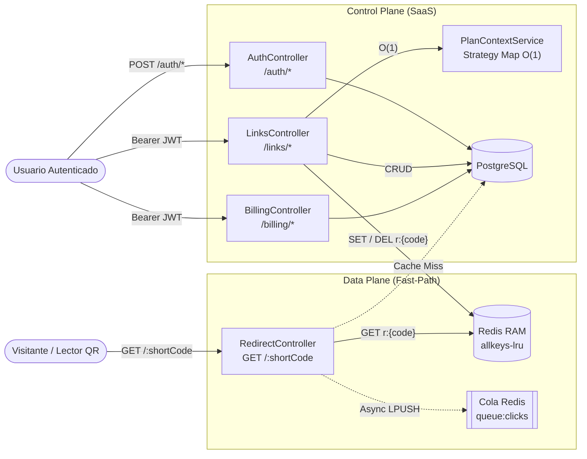
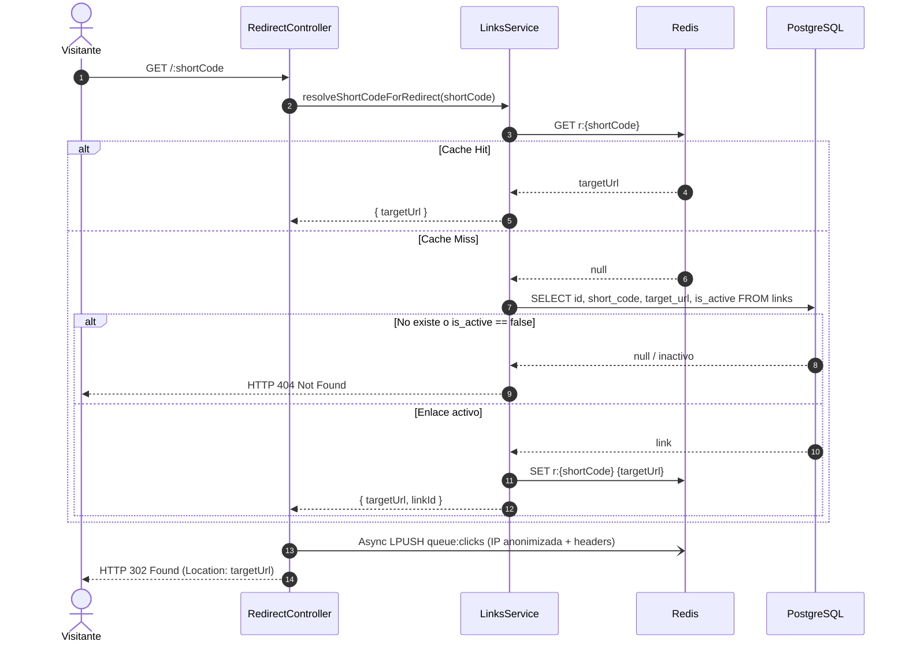
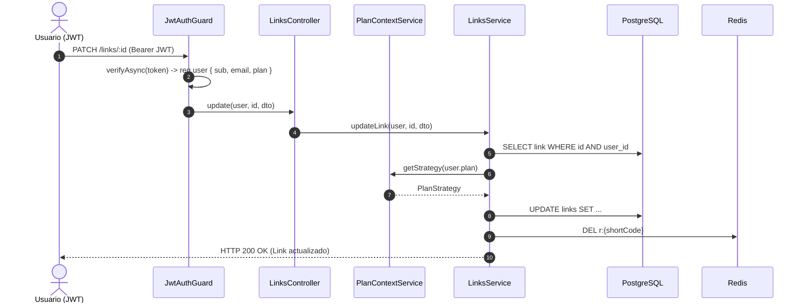

# Arquitectura del Sistema

El backend separa la ejecución en dos planos independientes sobre **NestJS + Fastify** para aislar la redirección pública de alta concurrencia respecto a la lógica transaccional del SaaS.

---

## 1. Vista General de Componentes

---

## 2. Secuencia UML — Fast-Path de Redirección (`Data Plane`)

---

## 3. Secuencia UML — Mutación e Invalidación Reactiva (`Control Plane`)

---

## 4. Decisiones Técnicas Clave

- **Fastify + `trustProxy: true`:** Minimiza overhead HTTP y extrae la IP real del cliente desde `X-Forwarded-For` detrás de proxies/CDNs.
- **Autorización Stateless:** El JWT transporta `{ sub, email, plan }`, permitiendo validar permisos y cuotas en memoria (`O(1)`) sin consultar la tabla `users` o `plans` en cada request.
- **Telemetría No Bloqueante:** `recordClickAsync` ejecuta `LPUSH queue:clicks` en modo *fire-and-forget*; cualquier latencia o fallo puntual en la cola analítica nunca bloquea ni rompe la respuesta `HTTP 302`.
- **Invalidación Reactiva (`DEL`):** En actualizaciones y borrados se elimina `r:{shortCode}` en lugar de sobreescribir ciegamente, evitando condiciones de carrera y destinos obsoletos.
