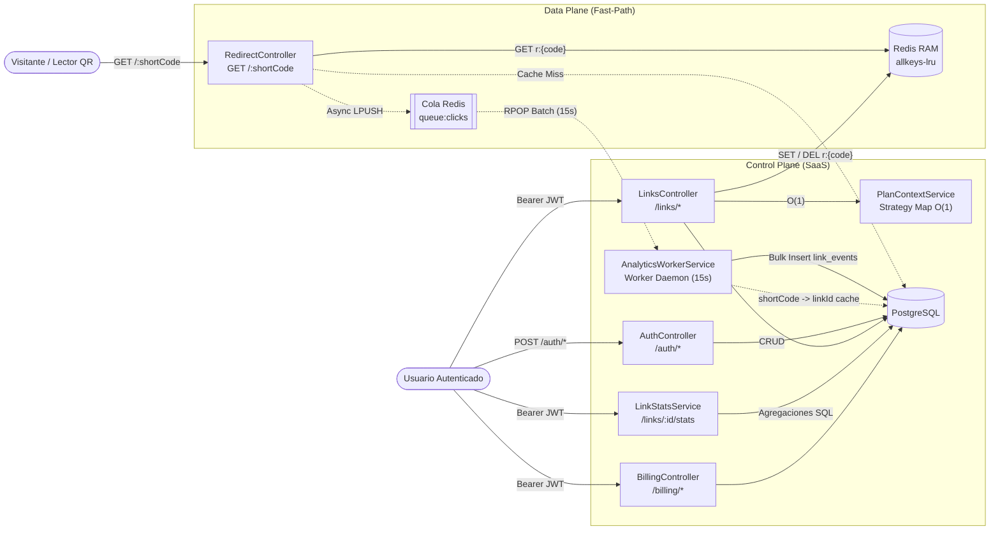
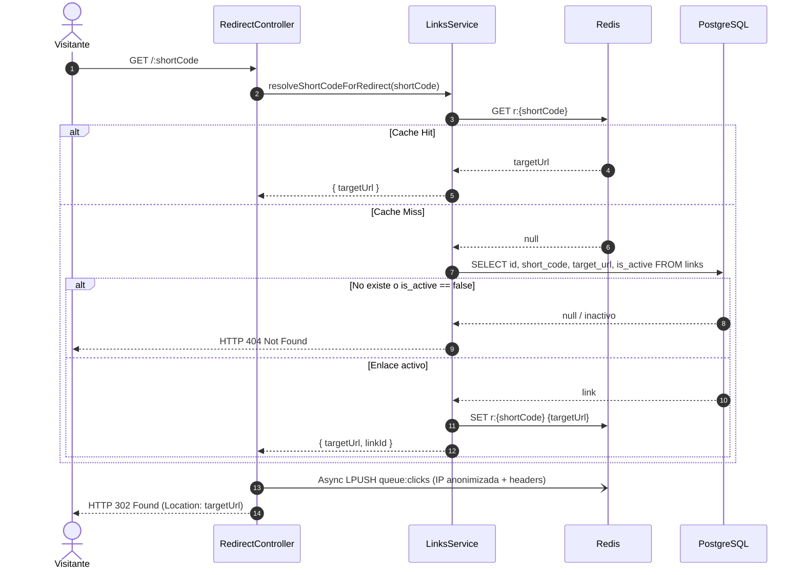
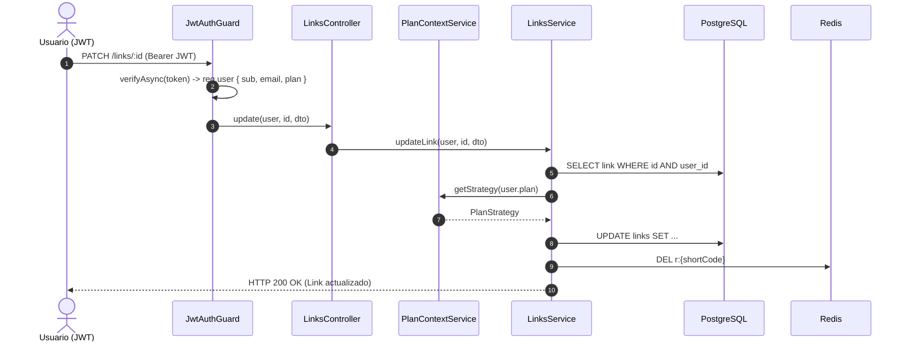
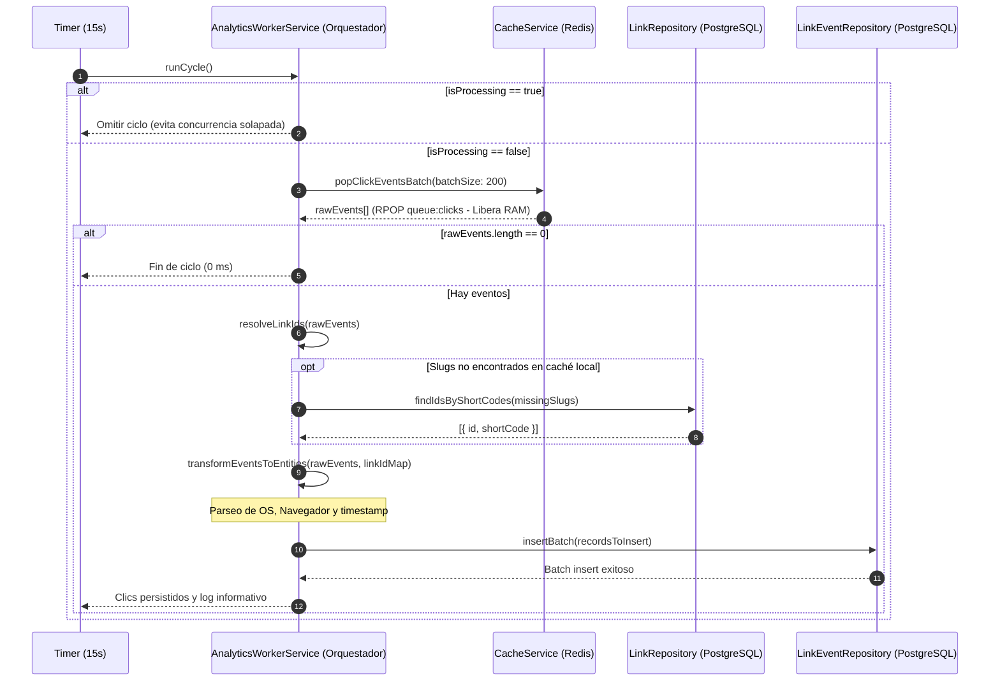

# Arquitectura del Sistema

El backend separa la ejecución en dos planos independientes sobre **NestJS + Fastify** para aislar la redirección pública de alta concurrencia respecto a la lógica transaccional del SaaS.

---

## 1. Vista General de Componentes

---

## 2. Secuencia UML — Fast-Path de Redirección (`Data Plane`)

---

## 3. Secuencia UML — Mutación e Invalidación Reactiva (`Control Plane`)

---

## 4. Secuencia UML — Ingestión en Lote y Vaciado de RAM (`AnalyticsWorkerService`)

El worker de analíticas procesa periódicamente cada 15 segundos la cola `queue:clicks` mediante el patrón **Orquestador**:

---

## 5. Decisiones Técnicas Clave

- **Fastify + `trustProxy: true` + `rawBody: true`:** Minimiza overhead HTTP, extrae la IP real del cliente desde `X-Forwarded-For` detrás de proxies/CDNs y conserva el buffer crudo (`req.rawBody`) indispensable para validar firmas criptográficas HMAC (`stripe-signature`) en Webhooks de Stripe.
- **Autorización Stateless con Resolución Reactiva de Plan:** El JWT transporta `{ sub, email, plan }`, permitiendo validar permisos y cuotas en memoria (`O(1)`). Cuando ocurren cambios de plan (`simulate-upgrade`, `cancel` o Webhooks asíncronos de Stripe), el backend rota el `accessToken` y reconcilia el plan efectivo en `UsersService` para habilitar funciones `PRO` de inmediato.
- **Siembra Automática del Catálogo de Planes (`OnModuleInit`):** `PlanContextService` y `UsersService` sincronizan de forma idempotente las estrategias registradas (`STARTER`, `PRO`) en la tabla `plans`, eliminando violaciones de llave foránea (`users.plan_id -> plans.id`) en entornos nuevos o contenedores recién inicializados.
- **Feature Flag Booleano para Pedidos Físicos (`ENABLE_PHYSICAL_ORDERS`):** El flujo de emisión de órdenes de impresión QR/NFC (tarjetas PVC, acrílicos, etiquetas NFC) se gobierna mediante un flag booleano configurable por entorno y conmutable en tiempo real (`PATCH /billing/config/physical-orders`).
- **Telemetría No Bloqueante & Consumo en Lotes:** `recordClickAsync` ejecuta `LPUSH queue:clicks` en modo *fire-and-forget* (Data Plane). Cada 15 segundos, `AnalyticsWorkerService` realiza `RPOP` en bloque (hasta 200 eventos), purga la memoria RAM de Redis y ejecuta una única inserción masiva (`INSERT INTO link_events VALUES (...)`) en PostgreSQL.
- **Tolerancia a Apagados (`Graceful Shutdown`):** Al detener el servicio (`onModuleDestroy`), el worker ejecuta un vaciado forzado final de los eventos pendientes en Redis para prevenir pérdida de datos.
- **Geolocalización Multi-Capa (Cloudflare + Nginx + GeoIP):** `country-resolver.helper.ts` extrae el país antes de anonimizar la IP. Prioriza cabeceras perimetrales (`CF-IPCountry`, `X-Country-Code`, `CloudFront-Viewer-Country`) en 0 ms; si no existen, consulta la base de datos offline `geoip-lite` (0.01 ms), y para IPs privadas/locales aplica un fallback configurable (`DEV_GEOIP_FALLBACK_COUNTRY`).
- **Invalidación Reactiva (`DEL`):** En actualizaciones y borrados se elimina `r:{shortCode}` en lugar de sobreescribir ciegamente, evitando condiciones de carrera y destinos obsoletos.
