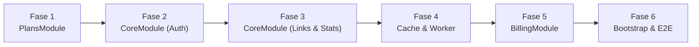

# Hoja de Ruta: Auditoría y Refactorización Módulo por Módulo del Backend

Este documento establece el plan de trabajo detallado para la revisión exhaustiva, archivo por archivo, de la arquitectura del backend construida sobre **NestJS 11**, **Fastify**, **TypeORM** y **Redis**.

---

## 1. Criterios y Estándares de Auditoría

En cada archivo se evaluarán los siguientes cinco pilares:

1. **Principio de Inversión de Dependencias (DIP) y Desacoplamiento:**
   - Los servicios de dominio no deben importar `Repository` de TypeORM directamente; deben utilizar tokens de repositorio (`@Inject(SYMBOL_TOKEN)`).
   - Ausencia total de dependencias circulares entre módulos.
2. **Manejo Robusto de Excepciones:**
   - Errores de cliente transformados a excepciones HTTP estándar de NestJS (`BadRequestException`, `NotFoundException`, `ForbiddenException`, `ConflictException`).
   - Bloques `try/catch` con tipado seguro (`catch (err: unknown)`) y logs descriptivos con contexto de depuración.
3. **Eficiencia y Concurrencia:**
   - Rutas críticas en `O(1)` sin consultas SQL redundantes.
   - Operaciones de caché atómicas y vaciado continuo de RAM en Redis (`AnalyticsWorkerService`).
4. **Seguridad y Validación Estricta:**
   - Control anti-IDOR mediante `{ id, userId }` en todas las consultas de usuario.
   - Validación DTO con `@IsNotEmpty()`, `@IsString()`, `@IsUUID()`, `@IsBoolean()` y `ValidationPipe` en modo estricto.
5. **Cobertura de Pruebas:**
   - Cada servicio y controlador debe contar con pruebas unitarias (`.spec.ts`) cubriendo *Happy Path*, *Sad Path* y *Casos Borde*.

---

## 2. Cronograma de Revisión por Módulo

---

### Fase 1: `PlansModule` (Catálogo de Planes y Patrón Strategy)

Módulo encargado de resolver las cuotas en memoria (`O(1)`) y asegurar la persistencia canónica del catálogo.

| Archivo | Puntos Clave a Auditar |
| :--- | :--- |
| [`src/plans/interfaces/plan-strategy.interface.ts`](file:///home/kevin/Documentos/personal/qr%20maker/src/plans/interfaces/plan-strategy.interface.ts) | Definición estricta de métodos del contrato (`getMaxActiveLinks`, `canCustomizeQrDesign`, etc.). |
| [`src/plans/strategies/starter-plan.strategy.ts`](file:///home/kevin/Documentos/personal/qr%20maker/src/plans/strategies/starter-plan.strategy.ts) | Cuota de 3 enlaces, 7 días de retención y bloqueo de personalización QR. |
| [`src/plans/strategies/pro-plan.strategy.ts`](file:///home/kevin/Documentos/personal/qr%20maker/src/plans/strategies/pro-plan.strategy.ts) | Cuota de 50 enlaces, 365 días de retención y habilitación de CNAME y colores. |
| [`src/plans/services/plan-context.service.ts`](file:///home/kevin/Documentos/personal/qr%20maker/src/plans/services/plan-context.service.ts) | Registro en memoria, fallback insensible a mayúsculas y método `OnModuleInit` (`ensureCatalogSeeded`). |
| [`src/plans/repositories/typeorm-plan.repository.ts`](file:///home/kevin/Documentos/personal/qr%20maker/src/plans/repositories/typeorm-plan.repository.ts) | Adaptador de persistencia TypeORM para la tabla `plans`. |
| [`src/plans/models/plan.entity.ts`](file:///home/kevin/Documentos/personal/qr%20maker/src/plans/models/plan.entity.ts) | Definición de columnas e índices de la tabla `plans`. |

---

### Fase 2: `CoreModule - Autenticación y Cuentas`

Gestión de ciclo de vida de usuarios, contraseñas seguras y firma de tokens JWT.

| Archivo | Puntos Clave a Auditar |
| :--- | :--- |
| [`src/core/auth/services/auth.service.ts`](file:///home/kevin/Documentos/personal/qr%20maker/src/core/auth/services/auth.service.ts) | Registro, login, hashing bcrypt, normalización de emails y emisión de tokens. |
| [`src/core/auth/services/users.service.ts`](file:///home/kevin/Documentos/personal/qr%20maker/src/core/auth/services/users.service.ts) | Integridad referencial en `updatePlanTier` y búsqueda limpia por UUID. |
| [`src/core/auth/controllers/auth.controller.ts`](file:///home/kevin/Documentos/personal/qr%20maker/src/core/auth/controllers/auth.controller.ts) | Endpoints `/auth/register`, `/auth/login` y `/auth/me` con rotación de JWT. |
| [`src/core/auth/guards/jwt-auth.guard.ts`](file:///home/kevin/Documentos/personal/qr%20maker/src/core/auth/guards/jwt-auth.guard.ts) | Extracción segura de cabecera `Authorization: Bearer <token>` y validación de expiración. |
| [`src/core/auth/repositories/typeorm-user.repository.ts`](file:///home/kevin/Documentos/personal/qr%20maker/src/core/auth/repositories/typeorm-user.repository.ts) | Consultas con `select: false` en contraseña y método `findByEmailWithPassword`. |
| [`src/core/auth/dto/`](file:///home/kevin/Documentos/personal/qr%20maker/src/core/auth/dto/) | Validaciones en `register.dto.ts` y `login.dto.ts` (límites de contraseña 8-72 caracteres). |

---

### Fase 3: `CoreModule - Enlaces Dinámicos y Analíticas`

Núcleo del Control Plane y generador de analíticas avanzadas.

| Archivo | Puntos Clave a Auditar |
| :--- | :--- |
| [`src/core/links/services/links.service.ts`](file:///home/kevin/Documentos/personal/qr%20maker/src/core/links/services/links.service.ts) | Orquestación de creación, edición, borrado, cuotas del plan y resolución reactiva del plan efectivo. |
| [`src/core/links/services/link-stats.service.ts`](file:///home/kevin/Documentos/personal/qr%20maker/src/core/links/services/link-stats.service.ts) | Ventana de retención temporal según plan (7d vs 365d), KPIs y cálculo de porcentajes. |
| [`src/core/links/controllers/links.controller.ts`](file:///home/kevin/Documentos/personal/qr%20maker/src/core/links/controllers/links.controller.ts) | Endpoints REST `/links`, `/links/:id`, `/links/:id/stats` y `/links/:id/qr` (PNG y SVG). |
| [`src/core/links/controllers/redirect.controller.ts`](file:///home/kevin/Documentos/personal/qr%20maker/src/core/links/controllers/redirect.controller.ts) | Fast-Path `GET /:shortCode` con redirección 302 y encolado no bloqueante. |
| [`src/core/links/helpers/country-resolver.helper.ts`](file:///home/kevin/Documentos/personal/qr%20maker/src/core/links/helpers/country-resolver.helper.ts) | Extracción de país vía Cloudflare (`cf-ipcountry`), Nginx o base local `geoip-lite`. |
| [`src/core/links/repositories/typeorm-link.repository.ts`](file:///home/kevin/Documentos/personal/qr%20maker/src/core/links/repositories/typeorm-link.repository.ts) | Consultas aisladas por `userId` e índices `idx_links_short_code`. |
| [`src/core/links/repositories/typeorm-link-event.repository.ts`](file:///home/kevin/Documentos/personal/qr%20maker/src/core/links/repositories/typeorm-link-event.repository.ts) | Consultas agregadas de analíticas y método `insertBatch` en bloque. |

---

### Fase 4: `CoreModule - Caché y Worker en Segundo Plano`

Data Plane en RAM y pipeline de vaciado de métricas hacia PostgreSQL.

| Archivo | Puntos Clave a Auditar |
| :--- | :--- |
| [`src/core/cache/cache.service.ts`](file:///home/kevin/Documentos/personal/qr%20maker/src/core/cache/cache.service.ts) | Manejo de conexión `ioredis`, operaciones `get`, `set`, `del`, `lpush`, `rpopBatch` y captura limpia de `CONFIG SET`. |
| [`src/core/links/workers/analytics-worker.service.ts`](file:///home/kevin/Documentos/personal/qr%20maker/src/core/links/workers/analytics-worker.service.ts) | Timer recurrente (15s), control de concurrencia (`isProcessing`), resolución de slugs en bloque e inserción masiva. |

---

### Fase 5: `BillingModule - Suscripciones y Pedidos Físicos`

Integración con Stripe, control por Feature Flag y pasarela sandbox.

| Archivo | Puntos Clave a Auditar |
| :--- | :--- |
| [`src/billing/services/billing.service.ts`](file:///home/kevin/Documentos/personal/qr%20maker/src/billing/services/billing.service.ts) | Orquestación de Checkout, Customer Portal, Feature Flag booleano de pedidos físicos y sandbox interactivo. |
| [`src/billing/services/stripe.service.ts`](file:///home/kevin/Documentos/personal/qr%20maker/src/billing/services/stripe.service.ts) | Wrapper del SDK de Stripe, `price_data` dinámico de respaldo y verificación HMAC de webhooks. |
| [`src/billing/controllers/billing.controller.ts`](file:///home/kevin/Documentos/personal/qr%20maker/src/billing/controllers/billing.controller.ts) | Endpoints de facturación, configuración, órdenes de hardware, sandbox complete y webhooks. |
| [`src/billing/repositories/typeorm-subscription.repository.ts`](file:///home/kevin/Documentos/personal/qr%20maker/src/billing/repositories/typeorm-subscription.repository.ts) | Consultas sobre `subscriptions` y método `upsert`. |
| [`src/billing/repositories/typeorm-order.repository.ts`](file:///home/kevin/Documentos/personal/qr%20maker/src/billing/repositories/typeorm-order.repository.ts) | Consultas sobre `orders` y carga relacional de `items`. |
| [`src/billing/dto/`](file:///home/kevin/Documentos/personal/qr%20maker/src/billing/dto/) | Validación de entrada para Checkout, órdenes físicas y conmutación de Feature Flags. |

---

### Fase 6: `Configuración Transversal, Docker y Validación E2E`

Punto de entrada de la aplicación y configuración de despliegue.

| Archivo | Puntos Clave a Auditar |
| :--- | :--- |
| [`src/main.ts`](file:///home/kevin/Documentos/personal/qr%20maker/src/main.ts) | Inicialización de Fastify con `{ rawBody: true }`, CORS, `ValidationPipe` y `trustProxy`. |
| [`src/openapi.config.ts`](file:///home/kevin/Documentos/personal/qr%20maker/src/openapi.config.ts) | Esquemas OpenAPI 3.0, Bearer Auth y endpoints `/docs`, `/docs-json`, `/docs-yaml`. |
| [`docker-compose.yml`](file:///home/kevin/Documentos/personal/qr%20maker/docker-compose.yml) | Propagación de variables de entorno, redes internas y healthchecks. |
| [`test/app.e2e-spec.ts`](file:///home/kevin/Documentos/personal/qr%20maker/test/app.e2e-spec.ts) | Suite integral E2E cubriendo autenticación, ciclo de vida de enlaces, Fast-Path, analíticas y facturación. |

---

## 3. Checklist de Comprobación Rápida al Finalizar

Al concluir la revisión de cada módulo:
- [x] Ejecutar pruebas unitarias específicas: `npm test -- <nombre_del_servicio>`
- [x] Validar cobertura de código: `npm run test:cov`
- [x] Ejecutar suite E2E completa: `npm run test:e2e`
- [x] Validar compilación limpia de TypeScript: `npm run build`
