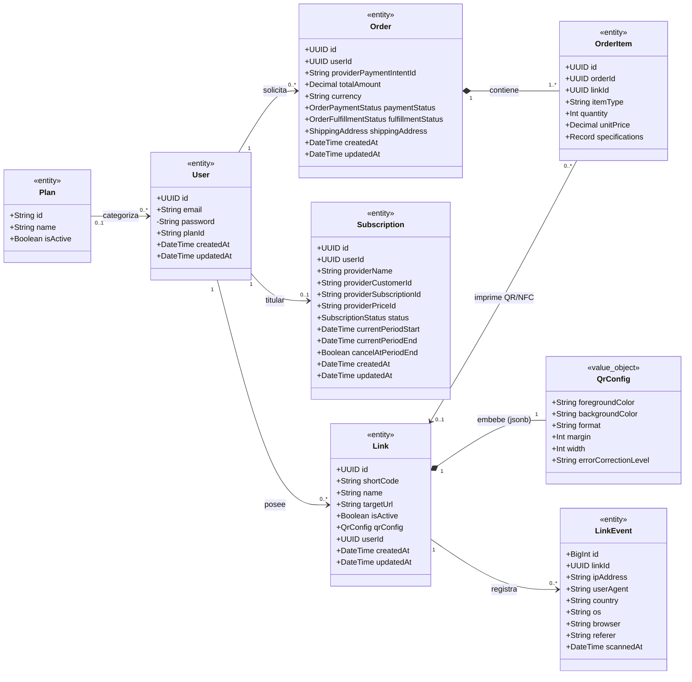
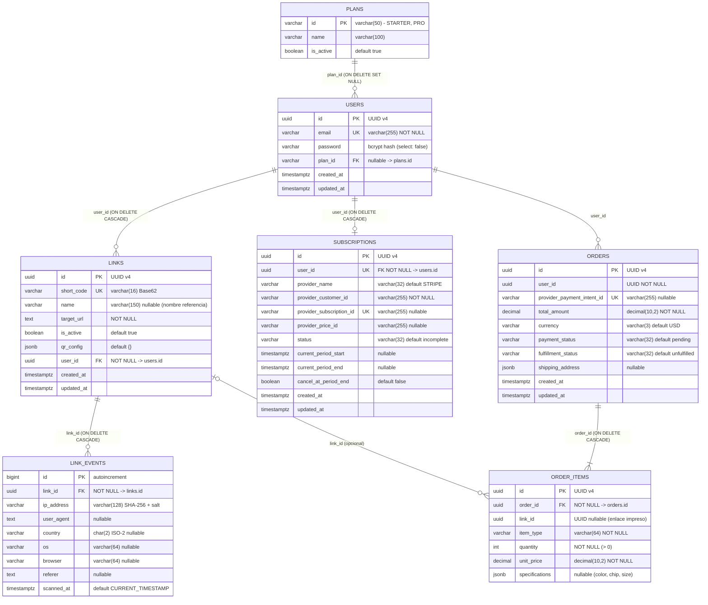

# Esquema de Base de Datos (UML) y Redis

Modelo de persistencia relacional en **PostgreSQL** (`TypeORM`) para el *Control Plane* y modelo clave-valor en **Redis** (`ioredis`) para el *Data Plane*.

---

## 1. Diagrama UML de Dominio (`classDiagram`)

---

## 2. Diagrama Entidad-Relación Físico (`erDiagram`)

---

## 3. Índices y Reglas de Integridad

| Tabla | Índice / Regla | Columnas | Propósito |
| :--- | :--- | :--- | :--- |
| `plans` | Auto-Seeding (`OnModuleInit`) | `(id)` `PK` | `PlanContextService` y `UsersService` garantizan de forma idempotente la existencia de `STARTER` y `PRO` antes de mutar `users.plan_id`. |
| `users` | `idx_users_email` | `(email)` `UNIQUE` | Búsqueda `O(log n)` en login y unicidad de cuentas. |
| `links` | `idx_links_short_code` | `(short_code)` `UNIQUE` | Resolución inmediata en *Cache Miss* y unicidad de slugs. |
| `links` | `idx_links_user_id` | `(user_id)` | Conteo de cuota por usuario y listados del dashboard. |
| `link_events` | `idx_link_events_link_id` | `(link_id)` | Filtrado por enlace y borrado en cascada eficiente. |
| `link_events` | `idx_link_events_scanned` | `(link_id, scanned_at DESC)` | Series de tiempo y analíticas recientes por enlace. |
| `subscriptions` | `idx_subscriptions_user_id` | `(user_id)` `UNIQUE` | Garantiza relación `1:1` entre usuario y suscripción. |
| `subscriptions` | `idx_subscriptions_provider_customer_id` | `(provider_customer_id)` | Correlación rápida en Webhooks (`invoice.payment_failed`, `customer.subscription.*`). |
| `orders` | `idx_orders_user_id` | `(user_id)` | Historial de pedidos físicos de placas y tarjetas NFC por cliente. |
| `order_items` | `idx_order_items_order_id` | `(order_id)` | Carga relacional eficiente de ítems por orden (`ON DELETE CASCADE`). |

---

## 4. Estructura en Memoria (Redis)

Configurado con política de desalojo **`allkeys-lru`** para liberar automáticamente enlaces fríos bajo presión de RAM.

| Clave | Tipo Redis | Operaciones | Estructura / Valor |
| :--- | :--- | :--- | :--- |
| `r:{shortCode}` | `STRING` | `GET`, `SET`, `DEL` | Cadena con `targetUrl` para respuesta `302` directa. |
| `queue:clicks` | `LIST` | `LPUSH`, `RPOP` | Buffer en RAM de clics entrantes. `LPUSH` asíncrono desde el Fast-Path y `RPOP` en lote cada 15s desde `AnalyticsWorkerService` para inserción en `link_events`. JSON: `{ shortCode, linkId?, ipAddress, userAgent, referer, scannedAt }`. |
