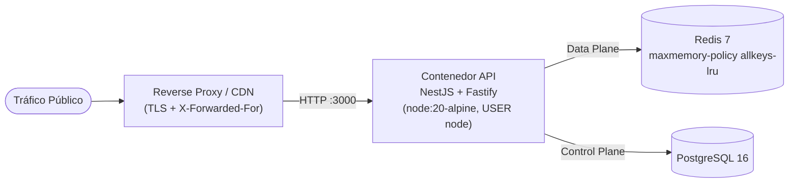

# Guía de Despliegue

Lineamientos de infraestructura, contenerización y operación en producción.

---

## 1. Topología de Despliegue



---

## 2. Imagen Docker de Producción

El `Dockerfile` utiliza construcción **multi-stage** sobre `node:20-alpine`, poda dependencias de desarrollo (`npm prune --omit=dev`) y ejecuta el proceso bajo el usuario sin privilegios `node`.

```bash
# Construir imagen
docker build -t dynamic-qr-api:latest .

# Ejecutar contenedor
docker run -d \
  --name dynamic-qr-api \
  -p 3000:3000 \
  --env-file .env \
  dynamic-qr-api:latest
```

Para infraestructura auxiliar local o staging (`postgres:16-alpine` + `redis:7-alpine` con `allkeys-lru` y `healthcheck`):

```bash
docker compose up -d
```

---

## 3. Requisitos Operativos Críticos

1. **Reverse Proxy y `trustProxy`:**
   - Fastify corre con `trustProxy: true`. El balanceador (Nginx, Traefik, Cloudflare, AWS ALB) debe sobrescribir/encadenar `X-Forwarded-For` de forma confiable para que la anonimización de IP refleje al visitante real.
2. **Política de Memoria en Redis:**
   - Configurar `--maxmemory <limite>` y `--maxmemory-policy allkeys-lru` en el servidor Redis para desalojar enlaces inactivos sin agotar RAM.
   - Si se utiliza un Redis administrado que restringe el comando `CONFIG SET`, `CacheService` captura la restricción de forma silenciosa en el arranque.
3. **Esquema PostgreSQL:**
   - Desactivar `DB_SYNCHRONIZE=false` en producción y gestionar cambios estructurales mediante migraciones controladas asegurando el índice compuesto `idx_link_events_scanned (link_id, scanned_at DESC)`.
4. **Apagado Limpio (`Graceful Shutdown`):**
   - `app.enableShutdownHooks()` está activo; ante señales `SIGTERM` / `SIGINT` (de Kubernetes o Docker), NestJS drena peticiones en vuelo y ejecuta `redis.quit()` antes de finalizar el proceso.

---

## 4. Checklist Pre-Producción

- [ ] `NODE_ENV=production` y `DB_SYNCHRONIZE=false`.
- [ ] `APP_BASE_URL` apuntando al dominio corto definitivo con `https://`.
- [ ] `JWT_SECRET` e `IP_HASH_SALT` rotados con secretos criptográficos únicos.
- [ ] `SWAGGER_ENABLED=false` si la documentación no debe ser pública.
- [ ] Redis configurado con `maxmemory` definido y política `allkeys-lru`.
