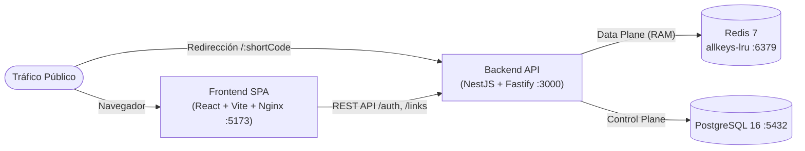

# Guía de Despliegue

Lineamientos de infraestructura, contenerización y operación en producción.

---

## 1. Topología de Despliegue



---

## 2. Orquestación Completa con Docker Compose

El archivo `docker-compose.yml` orquesta los 4 servicios integrados con redes internas y healthchecks:

```bash
# Levantar stack completo (PostgreSQL + Redis + API + Frontend)
docker compose up -d --build
```

- **Frontend:** `http://localhost:5173` (Nginx sirviendo SPA construida con Vite y React)
- **Backend API:** `http://localhost:3000` (FastifyAdapter con trustProxy)
- **Swagger Docs:** `http://localhost:3000/docs`
- **PostgreSQL 16:** `localhost:5432`
- **Redis 7:** `localhost:6379` (con `--maxmemory-policy allkeys-lru`)

---

## 3. Requisitos Operativos Críticos

1. **Reverse Proxy y `trustProxy`:**
   - Fastify corre con `trustProxy: true`. El balanceador (Nginx, Traefik, Cloudflare, AWS ALB) debe sobrescribir/encadenar `X-Forwarded-For` de forma confiable para que la anonimización de IP refleje al visitante real.
2. **Política de Memoria en Redis:**
   - Configurar `--maxmemory <limite>` y `--maxmemory-policy allkeys-lru` en el servidor Redis para desalojar enlaces inactivos sin agotar RAM.
   - Si se utiliza un Redis administrado que restringe el comando `CONFIG SET`, `CacheService` captura la restricción de forma silenciosa en el arranque.
3. **Esquema PostgreSQL:**
   - Desactivar `DB_SYNCHRONIZE=false` en producción y gestionar cambios estructurales mediante migraciones controladas asegurando el índice compuesto `idx_link_events_scanned (link_id, scanned_at DESC)`.
4. **Apagado Limpio (`Graceful Shutdown`):**
   - `app.enableShutdownHooks()` está activo; ante señales `SIGTERM` / `SIGINT` (de Kubernetes o Docker), NestJS drena peticiones en vuelo y ejecuta `redis.quit()` antes de finalizar el proceso.

---

## 4. Checklist Pre-Producción

- [ ] `NODE_ENV=production` y `DB_SYNCHRONIZE=false`.
- [ ] `APP_BASE_URL` apuntando al dominio corto definitivo con `https://`.
- [ ] `JWT_SECRET` e `IP_HASH_SALT` rotados con secretos criptográficos únicos.
- [ ] `SWAGGER_ENABLED=false` si la documentación no debe ser pública.
- [ ] Redis configurado con `maxmemory` definido y política `allkeys-lru`.
