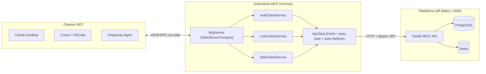

# Servidor MCP (Model Context Protocol) — QR Maker

Este submódulo implementa un servidor oficial basado en el **Model Context Protocol (MCP)** utilizando el SDK oficial de TypeScript (`@modelcontextprotocol/sdk`). Permite a modelos de lenguaje (Claude Desktop, Cursor, Antigravity, etc.) gestionar enlaces cortos, renderizar códigos QR dinámicos y consultar telemetría en lenguaje natural, comunicándose exclusivamente como cliente HTTP sobre la API REST del proyecto.

---

## 1. Arquitectura y Principio de Aislamiento

El servidor MCP está completamente desacoplado del runtime interno de NestJS y de la base de datos:



* **Comunicación Local por `stdio`:** Los mensajes de protocolo viajan por `stdin`/`stdout`. Todos los logs informativos y de depuración se dirigen a `stderr` para evitar corromper la trama JSON-RPC.
* **Cliente HTTP Desacoplado:** El submódulo interactúa con el servidor mediante llamadas estándar `fetch`, garantizando que todas las reglas de negocio, validaciones (`class-validator`), cuotas por plan y mecanismos de seguridad (anti-IDOR, anti-XSS) sean aplicadas por la API del backend.

---

## 2. Gestión Especial de Autenticación y Rotación de Tokens

Para garantizar una experiencia sin fricciones tanto en scripts locales como en interfaces agénticas interactivas, `ApiClient` y `AuthClientService` implementan un mecanismo híbrido:

1. **Credenciales en Variables de Entorno:**
   * Si defines `QR_API_EMAIL` y `QR_API_PASSWORD` (o `MCP_AUTH_EMAIL` y `MCP_AUTH_PASSWORD`), el cliente inicia sesión automáticamente en su primera petición llamando a `POST /auth/login`.
   * Si defines `QR_API_TOKEN` (o `MCP_AUTH_TOKEN`), utiliza dicho JWT directamente.
2. **Re-autenticación y Rotación Automática ante 401:**
   * Si el token JWT expira durante una sesión prolongada, el `ApiClient` detecta el código `HTTP 401 Unauthorized`. Si tiene credenciales en memoria, re-autentica de forma transparente en `POST /auth/login`, adquiere un nuevo JWT y reintenta la solicitud original sin interrumpir al agente.
3. **Refresco Reactivo mediante `GET /auth/me`:**
   * La herramienta `mcp_refresh_token` permite forzar una sincronización contra el backend. Como la API rota el token cuando el plan del usuario cambia, el `ApiClient` actualiza en memoria el nuevo `accessToken` retornado.
4. **Inicio de Sesión Interactivo:**
   * Si no se configuran variables de entorno previas, el agente puede invocar la herramienta `mcp_login` proporcionando el correo y la contraseña.

---

## 3. Acciones PERMITIDAS en el MCP

El servidor expone herramientas (`tools`), recursos (`resources`) y plantillas (`prompts`):

### Herramientas (`Tools`)

| Herramienta | Argumentos | Descripción |
| :--- | :--- | :--- |
| **`mcp_login`** | `email`, `password` | Inicia sesión y almacena el token JWT en memoria para las siguientes llamadas. |
| **`mcp_refresh_token`** | *(ninguno)* | Refresca el token actual y sincroniza el perfil consultando `GET /auth/me`. |
| **`mcp_get_profile`** | *(ninguno)* | Devuelve el ID, correo, plan actual (`STARTER` o `PRO`) y estado de la sesión. |
| **`create_link`** | `name`, `targetUrl`, `shortCode?`, `qrConfig?` | Crea un enlace corto y su QR dinámico, precalentando la clave en Redis. |
| **`list_links`** | `page?`, `limit?`, `search?`, `isActive?` | Lista y pagina los enlaces del usuario con filtros opcionales. |
| **`get_link`** | `id` (UUID) | Obtiene la configuración completa de un enlace por su identificador único. |
| **`update_link`** | `id`, `name?`, `targetUrl?`, `isActive?`, `qrConfig?` | Modifica el enlace o su diseño e invalida de inmediato la caché de redirección. |
| **`delete_link`** | `id` (UUID) | Elimina el enlace y purga la clave `r:{shortCode}` en Redis. |
| **`get_qr_code`** | `id` (UUID), `format?` (`svg` \| `png`) | Renderiza el código QR. Devuelve texto `SVG` vectorial o Data URI en `PNG` base64. |
| **`get_link_stats`** | `id` (UUID), `period?` (`7d` \| `30d` \| `90d` \| `365d`) | Retorna KPIs (clics, visitantes únicos, serie temporal) y desgloses (países, SO, navegadores, referrers). |
| **`get_hardware_orders`** | `paymentStatus?`, `fulfillmentStatus?` | Consulta el historial de compras de insumos físicos (tarjetas PVC, expositores acrílicos, stickers NFC) emitidas por el cliente (`GET /billing/orders`). |
| **`get_hardware_order_detail`** | `id` (UUID) | Obtiene los detalles completos de una orden física por su UUID (ítems, dirección de entrega, tracking de envío y estados). |
| **`get_subscription_status`** | *(ninguno)* | Consulta el estado y periodo de la suscripción SaaS recurrente vinculada a la cuenta (`GET /billing/subscription`). |
| **`get_hardware_catalog_config`** | *(ninguno)* | Consulta los precios vigentes de insumos físicos y si los pedidos están habilitados (`GET /billing/config`). |

### Recursos Pasivos (`Resources`)

* **`qr://profile`:** Datos del usuario autenticado y su plan.
* **`qr://links`:** Catálogo completo de enlaces registrados por el usuario.
* **`qr://links/{id}/stats`:** Plantilla dinámica para consultar telemetría directa de cualquier enlace.
* **`qr://orders`:** Historial completo de compras de insumos físicos de hardware.
* **`qr://orders/{id}`:** Plantilla dinámica para consultar el detalle de una orden física.
* **`qr://subscription`:** Detalle de la suscripción SaaS activa del usuario en Stripe.

### Plantillas Asistidas (`Prompts`)

* **`create-campaign-link`:** Flujo guiado para armar campañas con parámetros UTM (`source`, `medium`, `campaign`) y estilo QR de marca.
* **`audit-link-traffic`:** Auditoría integral de tráfico que analiza retención, fuentes y recomendaciones de conversión.
* **`track-hardware-orders`:** Seguimiento y resumen del estado de manufactura y despacho de los pedidos físicos de tarjetas y expositores NFC.

---

## 4. Acciones NO PERMITIDAS (Excluidas por Diseño y Seguridad)

Por estrictos principios de seguridad y control financiero, **el servidor MCP tiene explícitamente vetadas las transacciones monetarias y mutaciones de suscripción**:

1. 🚫 **Mutaciones de Planes y Facturación SaaS:**
   * **Prohibido:** Actualizar o simular cambios de plan (`POST /billing/simulate-upgrade`).
   * **Prohibido:** Iniciar sesiones de Stripe Checkout para suscripciones (`POST /billing/checkout/subscription`).
   * **Prohibido:** Cancelar suscripciones activas (`POST /billing/cancel`).
   * **Prohibido:** Generar URLs temporales hacia el Stripe Customer Portal (`GET /billing/portal`).
2. 🚫 **Compra y Emisión de Hardware Físico (NFC y Acrílicos):**
   * **Prohibido:** Crear compras de insumos físicos o sesiones de pago (`POST /billing/checkout/physical`).
   * **Prohibido:** Emitir órdenes físicas directas a manufactura (`POST /billing/orders/direct`).
   * **Prohibido:** Modificar en caliente el feature flag de pedidos físicos (`PATCH /billing/config/physical-orders`).
   *(Nota: La consulta del historial de órdenes previas `GET /billing/orders` sí está permitida al ser de sólo lectura).*
3. 🚫 **Administración Global y Webhooks:**
   * **Prohibido:** Registro masivo no supervisado de cuentas (`POST /auth/register`).
   * **Prohibido:** Disparar o simular eventos Webhook HMAC de Stripe (`POST /billing/webhook`).
   * **Prohibido:** Evadir cuotas del plan (la API rechaza con `403 Forbidden` cualquier intento de exceder los límites del plan del usuario).

---

## 5. Configuración e Instalación

### Variables de Entorno Opcionales (`.env`)

```env
# URL de la API de QR Maker (por defecto http://localhost:3000)
QR_API_URL=http://localhost:3000

# Credenciales para autenticación automática y auto-refresh
QR_API_EMAIL=usuario@ejemplo.com
QR_API_PASSWORD=TuPasswordSeguro123

# O alternativamente, un token Bearer pre-emitido:
# QR_API_TOKEN=eyJhbGciOi...
```

### Ejecución Local

```bash
# Ejecutar en modo desarrollo con ts-node:
npm run mcp:dev

# Compilar y ejecutar la versión distribuida:
npm run build
npm run mcp
```

### Configuración en Clientes MCP

#### A. Claude Desktop (`claude_desktop_config.json`)

```json
{
  "mcpServers": {
    "qr-maker": {
      "command": "node",
      "args": ["/ruta/absoluta/a/qr maker/dist/mcp/index.js"],
      "env": {
        "QR_API_URL": "http://localhost:3000",
        "QR_API_EMAIL": "cliente@empresa.com",
        "QR_API_PASSWORD": "MiPassword123"
      }
    }
  }
}
```

#### B. Cursor (`.cursor/mcp.json`)

```json
{
  "mcpServers": {
    "qr-maker": {
      "command": "node",
      "args": ["${workspaceFolder}/dist/mcp/index.js"],
      "env": {
        "QR_API_URL": "http://localhost:3000",
        "QR_API_EMAIL": "cliente@empresa.com",
        "QR_API_PASSWORD": "MiPassword123"
      }
    }
  }
}
```

---

## 6. Pruebas de Funcionamiento

Puedes verificar manualmente que el protocolo responde correctamente a través de la tubería estándar:

```bash
printf '{"jsonrpc":"2.0","id":1,"method":"initialize","params":{"protocolVersion":"2024-11-05","capabilities":{},"clientInfo":{"name":"test","version":"1.0"}}}\n{"jsonrpc":"2.0","method":"notifications/initialized"}\n{"jsonrpc":"2.0","id":2,"method":"tools/list"}\n' | node dist/mcp/index.js
```
