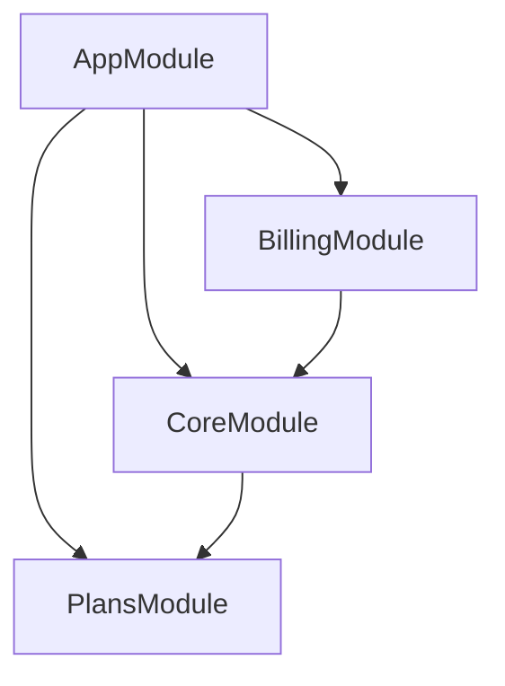
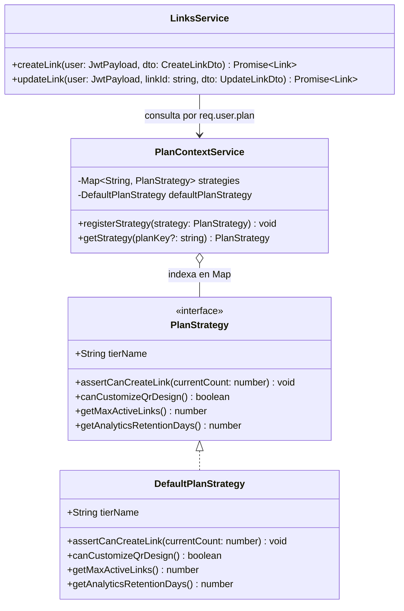

# Módulos y Patrón Strategy

La aplicación se divide en tres módulos de dominio desacoplados sin dependencias circulares.

---

## 1. Grafo de Dependencias Modulares



| Módulo | Directorio | Responsabilidad | Exporta |
| :--- | :--- | :--- | :--- |
| **`PlansModule`** | `src/plans/` | Motor en memoria de cuotas y capacidades por nivel de suscripción. Cero consultas SQL en servicios. | `PlanContextService`, `TypeOrmModule` |
| **`CoreModule`** | `src/core/` | Autenticación JWT/`bcrypt`, CRUD `/links`, renderizado QR (`png`/`svg`), `CacheService` (`ioredis`) y `RedirectController` (`/:shortCode`). | `JwtAuthGuard`, `JwtModule`, `CacheService`, `AuthService`, `LinksService`, `TypeOrmModule` |
| **`BillingModule`** | `src/billing/` | Entidad `Subscription` y consulta base de estado de suscripción (`GET /billing/subscription`). | `BillingService`, `TypeOrmModule` |

---

## 2. Diagrama UML — Motor de Planes (`Strategy Pattern`)



---

## 3. Cómo Agregar un Nuevo Plan

1. Crear una clase en `src/plans/strategies/` que implemente `PlanStrategy` (ej. `ProPlanStrategy` con `readonly tierName = 'PRO'`).
2. Añadirla al arreglo del proveedor `PLAN_STRATEGIES` dentro de `src/plans/plans.module.ts`.
3. `PlanContextService` la indexará automáticamente en el `Map` sin modificar `LinksService` ni los controladores (*Open/Closed Principle*).

---

## 4. Estructura Interna por Módulo

```text
src/
├── core/
│   ├── auth/         # controllers/, services/, guards/, decorators/, interfaces/, dto/
│   ├── links/        # controllers/ (links + redirect), services/, dto/
│   ├── cache/        # cache.service.ts (ioredis)
│   └── models/       # user.entity.ts, link.entity.ts, link-event.entity.ts
├── plans/
│   ├── interfaces/   # plan-strategy.interface.ts
│   ├── strategies/   # default-plan.strategy.ts
│   ├── services/     # plan-context.service.ts
│   └── models/       # plan.entity.ts
└── billing/
    ├── controllers/  # billing.controller.ts
    ├── services/     # billing.service.ts
    ├── dto/          # subscription-response.dto.ts
    └── models/       # subscription.entity.ts
```
