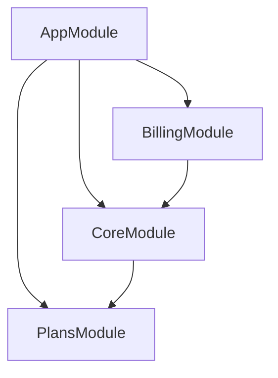
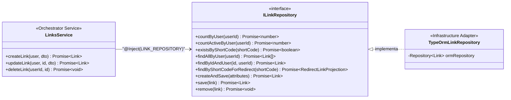
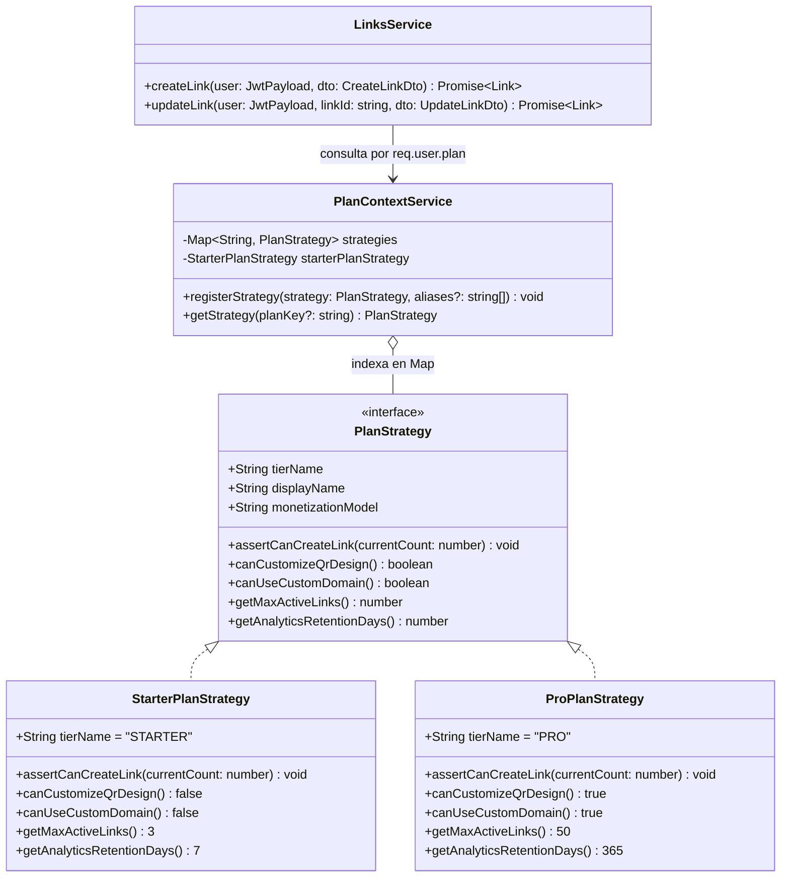

# Módulos, Patrón Orquestador, Repositorios y Strategy

La aplicación se divide en tres módulos de dominio desacoplados sin dependencias circulares, aplicando principios **SOLID** (especialmente *Single Responsibility*, *Open/Closed*, *Interface Segregation* y *Dependency Inversion*) y el patrón **Orquestador**.

---

## 1. Grafo de Dependencias Modulares



| Módulo | Directorio | Responsabilidad | Exporta |
| :--- | :--- | :--- | :--- |
| **`PlansModule`** | `src/plans/` | Motor en memoria de cuotas (`PlanStrategy`) y repositorio de planes (`PLAN_REPOSITORY`). | `PlanContextService`, `PLAN_REPOSITORY`, `TypeOrmModule` |
| **`CoreModule`** | `src/core/` | Orquestadores de negocio (`AuthService`, `LinksService`), repositorios de dominio (`USER_REPOSITORY`, `LINK_REPOSITORY`), `CacheService` (`ioredis`) y `RedirectController` (`/:shortCode`). | `USER_REPOSITORY`, `LINK_REPOSITORY`, `JwtAuthGuard`, `JwtModule`, `CacheService`, `AuthService`, `LinksService`, `TypeOrmModule` |
| **`BillingModule`** | `src/billing/` | Orquestador `BillingService`, repositorio `SUBSCRIPTION_REPOSITORY` y consulta de estado de suscripción (`GET /billing/subscription`). | `BillingService`, `SUBSCRIPTION_REPOSITORY`, `TypeOrmModule` |

---

## 2. Capa de Repositorio Estricta (Desacoplamiento del ORM - DIP)

Los servicios de dominio (`AuthService`, `LinksService`, `BillingService`) **no importan ni conocen TypeORM**. Dependen exclusivamente de contratos de dominio inyectados mediante tokens `Symbol`:



| Token de Inyección | Interfaz de Dominio | Adaptador TypeORM |
| :--- | :--- | :--- |
| `USER_REPOSITORY` | `IUserRepository` | `TypeOrmUserRepository` |
| `LINK_REPOSITORY` | `ILinkRepository` | `TypeOrmLinkRepository` |
| `PLAN_REPOSITORY` | `IPlanRepository` | `TypeOrmPlanRepository` |
| `SUBSCRIPTION_REPOSITORY` | `ISubscriptionRepository` | `TypeOrmSubscriptionRepository` |

---

## 3. Patrón Orquestador en Servicios de Negocio

Cada método público de los servicios actúa como un **Orquestador declarativo** de un caso de uso específico, coordinando pasos atómicos delegados a funciones auxiliares privadas con responsabilidad única (*SRP*):

* **`LinksService.createLink` (Orquestador):**
  1. `resolvePlanStrategy(user.plan)`
  2. `enforceCreationQuotas(user.sub, strategy, dto.qrConfig)`
  3. `resolveOrAllocateShortCode(dto.shortCode)`
  4. `persistNewLink(user.sub, shortCode, dto)`
  5. `warmUpRedirectCache(savedLink)`
* **`LinksService.updateLink` (Orquestador):**
  1. `findOneByUser(user.sub, linkId)`
  2. `resolvePlanStrategy(user.plan)`
  3. `applyAndValidateLinkUpdates(link, dto, user.sub, strategy)`
  4. `linkRepository.save(link)`
  5. `invalidateRedirectCache(updatedLink.shortCode)`
* **`AuthService.register` (Orquestador):**
  1. `normalizeEmail(dto.email)`
  2. `assertEmailIsAvailable(normalizedEmail)`
  3. `ensureDefaultPlanExists()`
  4. `hashPassword(dto.password)`
  5. `persistNewUser(normalizedEmail, passwordHash)`
  6. `buildAuthSessionResponse(savedUser)`

---

## 4. Diagrama UML y Matriz de Planes (`Strategy Pattern`)

| Característica | `StarterPlanStrategy` (`STARTER` / Default) | `ProPlanStrategy` (`PRO` / Premium) |
| :--- | :--- | :--- |
| **Nombre Comercial** | Plan Starter (Gratuito / Físico) | Plan Pro / Premium ($9 - $15/mes) |
| **Límite de enlaces dinámicos** | Hasta **3** enlaces activos | Hasta **50** enlaces activos |
| **Retención de analíticas** | **7 días** (purga automática semanal) | **365 días** (histórico anual) |
| **Personalización del QR** | **No** (estándar en blanco y negro `#000000` / `#FFFFFF`) | **Sí** (colores hexadecimales de marca y `logoUrl` SVG/PNG al centro) |
| **Dominio personalizado** | **No** (utiliza el dominio base del servicio) | **Sí** (soporte para subdominio CNAME propio) |
| **Enfoque de monetización** | Incluido de por vida con la compra del acrílico o chip NFC | Suscripción recurrente para negocios en crecimiento o múltiples sucursales |



---

## 5. Estructura Interna por Módulo

```text
src/
├── core/
│   ├── auth/
│   │   ├── controllers/    # auth.controller.ts
│   │   ├── services/       # auth.service.ts (Orquestador puro sin TypeORM)
│   │   ├── repositories/   # typeorm-user.repository.ts (Adaptador ORM)
│   │   ├── interfaces/     # user-repository.interface.ts, jwt-payload.interface.ts
│   │   ├── guards/         # jwt-auth.guard.ts
│   │   └── dto/            # register.dto.ts, login.dto.ts, auth-response.dto.ts
│   ├── links/
│   │   ├── controllers/    # links.controller.ts, redirect.controller.ts
│   │   ├── services/       # links.service.ts (Orquestador puro sin TypeORM)
│   │   ├── repositories/   # typeorm-link.repository.ts (Adaptador ORM)
│   │   ├── interfaces/     # link-repository.interface.ts
│   │   └── dto/            # create-link.dto.ts, update-link.dto.ts, qr-config.dto.ts
│   ├── cache/              # cache.service.ts (ioredis)
│   └── models/             # user.entity.ts, link.entity.ts, link-event.entity.ts
├── plans/
│   ├── interfaces/         # plan-strategy.interface.ts, plan-repository.interface.ts
│   ├── repositories/       # typeorm-plan.repository.ts (Adaptador ORM)
│   ├── strategies/         # default-plan.strategy.ts
│   ├── services/           # plan-context.service.ts
│   └── models/             # plan.entity.ts
└── billing/
    ├── controllers/        # billing.controller.ts
    ├── services/           # billing.service.ts (Orquestador puro sin TypeORM)
    ├── repositories/       # typeorm-subscription.repository.ts (Adaptador ORM)
    ├── interfaces/         # subscription-repository.interface.ts
    ├── dto/                # subscription-response.dto.ts
    └── models/             # subscription.entity.ts
```
