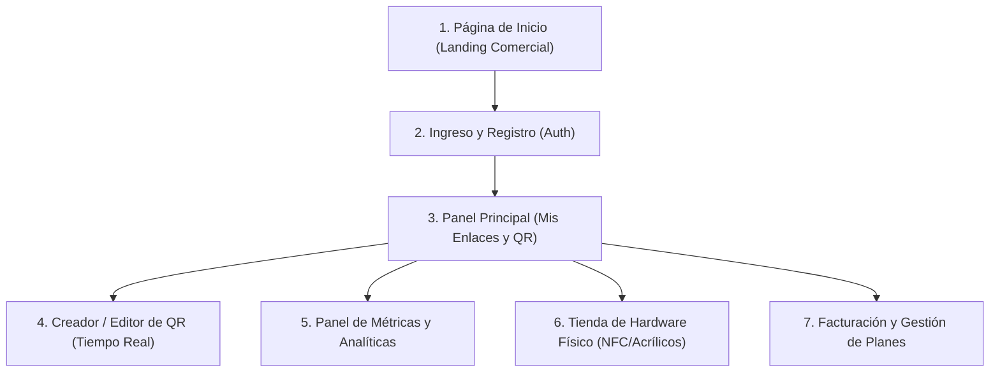

# Guía de Producto y Brief de Diseño UI/UX

> **Destinatario:** Diseñadores Gráficos, Diseñadores de Producto (UI/UX) y Desarrolladores Frontend.  
> **Propósito:** Explicar qué hace la plataforma, a quién ayuda y cómo debe estructurarse la experiencia visual completa para rediseñar la interfaz desde cero.  
> **Tono del documento:** Alto nivel, enfocado en negocio y usuario, **sin tecnicismos de programación**.

---

## 1. Visión del Producto: ¿Qué es y qué problema resuelve?

### El Problema del Mundo Real
Cuando un restaurante, una clínica o un profesional imprime 500 cartas, volantes o tarjetas de presentación con un código QR tradicional, **ese código es estático**. Si la carta del menú cambia de enlace, si el archivo de Google Drive se mueve o si la empresa renueva su página web, **todos los materiales impresos van a la basura**, costando miles de dólares y semanas de reimpresión.

### Nuestra Solución: Códigos QR Dinámicos + Hardware Inteligente NFC
Esta plataforma permite crear **códigos QR dinámicos**. El código impreso nunca cambia, pero el dueño puede entrar a su panel desde su teléfono o computadora y **cambiar la página a la que apunta con un solo clic**, tantas veces como quiera.

Además, el negocio no solo vende el software digital; también vende **hardware físico premium**:
* **Expositores acrílicos para mesas y mostradores:** Grabados con el código QR y equipados con un chip inteligente NFC (para que el cliente solo acerque su teléfono o escanee el QR).
* **Tarjetas inteligentes PVC (tipo tarjeta de crédito):** Para profesionales y ejecutivos que comparten sus datos de contacto o portafolio con solo acercar la tarjeta al móvil de un cliente.
* **Stickers resinados NFC:** Para pegar en mesas, cajas registradoras, vitrinas o vehículos de reparto.

---

## 2. Nuestros Usuarios Clave (Personas)

1. **El Dueño de Restaurante o Cafetería:**
   * Necesita colocar un acrílico elegante en cada mesa.
   * Modifica el menú, promociones del fin de semana o carta de bebidas con frecuencia.
   * Quiere saber cuántas personas escanearon el menú hoy y a qué horas hay más comensales.
2. **El Profesional / Emprendedor / Networking:**
   * Usa una tarjeta inteligente de PVC para eventos y conferencias.
   * Quiere cambiar el destino de su tarjeta (hoy a su WhatsApp, mañana a su LinkedIn o catálogo de servicios).
   * Valora una imagen de marca moderna y tecnológica.
3. **La Empresa con Múltiples Sucursales o Tienda Minorista:**
   * Requiere personalizar el código QR con los colores corporativos de su marca.
   * Compra decenas de stands acrílicos o stickers para sus locales.
   * Necesita analíticas completas para medir el impacto de sus campañas a lo largo del año.

---

## 3. Modelo de Negocio (Lo que la UI debe reflejar)

| Nivel | Enfoque | Lo que incluye en la interfaz |
| :--- | :--- | :--- |
| **Plan Starter (Gratuito o con compra de hardware)** | Para usuarios que están probando o que solo tienen 1 o 2 locales. | • Hasta **3 códigos QR activos**. • QR estándar en blanco y negro. • Analíticas básicas de los últimos **7 días**. • Botón visible de "Subir a Pro" cuando intentan usar funciones premium. |
| **Plan Pro ($19 / mes)** | Para negocios en crecimiento que necesitan control total. | • Hasta **50 códigos QR activos**. • **Personalización de colores** (el color de la marca del cliente). • Analíticas avanzadas de **365 días** (histórico anual). • Insignia dorada o distintivo "PRO" en el encabezado. |
| **Tienda de Hardware Físico** | Compra única con envío a domicilio. | • Catálogo de productos (Acrílicos de mesa, Tarjetas PVC, Stickers). • Selector de cantidad, dirección de entrega y pasarela de pago fácil. |

---

## 4. Mapa de Pantallas a Diseñar

El nuevo diseño debe sustituir la interfaz de prueba actual por una experiencia moderna, fluida y coherente dividida en los siguientes módulos:

---

### Pantalla 1: Página de Inicio (Landing Page Comercial)
* **Objetivo:** Vender la solución tanto a quienes buscan software como a quienes buscan los productos físicos.
* **Elementos indispensables:**
  * **Sección Hero:** Título atractivo (ej. *"Menús, tarjetas y enlaces que nunca vencen"*), llamada a la acción principal (*"Crear mi primer QR gratis"*) y visualización de una tarjeta física y un expositor acrílico con un teléfono acercándose.
  * **Demostración interactiva:** Un pequeño simulador donde el visitante escribe una URL y ve cómo se genera un código QR al instante.
  * **Casos de Uso:** Tarjetas de presentación, menús de restaurantes, inmobiliarias, eventos.
  * **Vitrina de Productos Físicos:** Fotografías o renders de alta calidad de los soportes acrílicos y tarjetas PVC.
  * **Tabla Comparativa de Precios:** Starter vs Pro con botón de contratación directa.
  * **Pie de página:** Enlaces de soporte, términos y contacto.

---

### Pantalla 2: Flujo de Ingreso y Registro
* **Objetivo:** Registro sin fricciones en menos de 30 segundos.
* **Elementos:**
  * Formulario limpio con correo y contraseña.
  * Indicador visual de seguridad en la contraseña.
  * Enlace para cambiar rápidamente entre "Iniciar Sesión" y "Crear Cuenta".
  * Mensaje claro de bienvenida que recuerde que el registro incluye el plan Starter de por vida.

---

### Pantalla 3: Panel Principal (Dashboard)
* **Objetivo:** Centro de comando diario donde el usuario ve y controla todos sus enlaces y códigos QR.
* **Elementos:**
  * **Encabezado superior:** Saludo al usuario, estado actual de su plan (`STARTER` o `PRO`), botón de actualizar a Pro y acceso a su perfil.
  * **Barra de resumen (KPIs rápidos):**
    * Total de escaneos acumulados este mes.
    * Enlaces activos (ej. `2 de 3 disponibles` en Starter, o `14 de 50` en Pro con una barra de progreso visual).
  * **Buscador y filtros:** Para encontrar enlaces por nombre o palabra clave.
  * **Listado de Tarjetas de Enlaces:** Cada enlace debe presentarse como una tarjeta visual moderna con:
    * Miniatura del código QR generado.
    * Nombre asignado (ej. *"Menú Principal Sucursal Centro"*).
    * Enlace corto (ej. `app.com/menu-centro`) con botón de **Copiar en un clic**.
    * URL final a la que redirige actualmente con botón para **Editar en cualquier momento**.
    * **Interruptor (Switch On/Off):** Para pausar o reactivar el enlace sin tener que borrarlo.
    * Botón de acceso rápido a **"Ver Estadísticas"**.
    * Menú de tres puntos: Descargar QR (PNG / SVG), Pedir en acrílico/tarjeta, o Eliminar.

---

### Pantalla 4: Creador y Editor de Código QR (Vista Previa en Vivo)
* **Objetivo:** Diseñar o modificar un QR dinámico viendo los resultados en tiempo real.
* **Diseño recomendado:** Pantalla dividida en dos columnas:
  * **Columna Izquierda (Controles):**
    * Campo de nombre del enlace.
    * Campo de URL de destino (con validación visual verde si es una URL válida).
    * Selector de código corto (automático o personalizado).
    * **Paleta de Colores (Exclusivo Plan Pro):**
      * Selector de color del código (primer plano) y color de fondo.
      * Si el usuario está en Starter, estos selectores deben mostrarse con un icono de candado elegante y el mensaje: *"Personaliza con los colores de tu marca desbloqueando el Plan Pro"*.
    * Selector de formato de descarga: Botones para descargar en **PNG** (para redes o imprimir en casa) o **SVG vectorial** (para imprentas profesionales).
  * **Columna Derecha (Previsualización en Vivo):**
    * El código QR se actualiza en pantalla conforme el usuario escribe o cambia colores.
    * Botón para probarlo directamente escaneándolo con el teléfono frente al monitor.

---

### Pantalla 5: Panel de Analíticas y Reportes
* **Objetivo:** Mostrarle al cliente el valor real de su inversión mediante datos comprensibles.
* **Elementos:**
  * **Selector de período:** selector de rango (Últimos 7 días para Starter; Últimos 30, 90 o 365 días para Pro).
  * **Tarjetas de impacto:**
    * Total de visitas / escaneos.
    * Visitantes únicos (personas reales).
    * Dispositivo más usado (ej. *"84% desde iPhone"*).
    * País principal de procedencia.
  * **Gráfico de evolución temporal:** Gráfico de línea suave que muestra los picos de escaneos día a día.
  * **Desgloses visuales:**
    * **Dispositivos y Sistemas Operativos:** Barra porcentual (iOS, Android, Windows, Mac).
    * **Navegadores:** (Chrome, Safari, Firefox).
    * **Top de Países:** Banderas y porcentajes.
    * **Páginas de Origen:** (Instagram, WhatsApp, Escaneo de cámara directo, Google).

---

### Pantalla 6: Tienda de Hardware Físico NFC y Placas
* **Objetivo:** Comprar tarjetas o placas acrílicas personalizadas listas para usar.
* **Elementos:**
  * **Selector de producto:** Tarjeta de presentación PVC, Expositor acrílico de mesa, o Sticker NFC.
  * **Asociación de QR:** Menú desplegable para elegir cuál de los enlaces creados en el Dashboard vendrá grabado en el producto.
  * **Selector de cantidad y cálculo de precio en vivo:**
    * Stand acrílico: $15.00 c/u.
    * Tarjeta PVC: $10.00 c/u.
    * Tarjeta inteligente empresarial: $12.50 c/u.
    * Sticker NFC: $5.00 c/u.
  * **Formulario de Envío:** Nombre completo, dirección, ciudad, teléfono de contacto.
  * **Resumen de Pedido y Botón de Pago:** Botón seguro con icono de candado que lleva al pago protegido.
  * **Pestaña de Historial de Pedidos:** Donde el usuario consulta sus compras previas y ve el estado de manufactura (*En producción*, *Pagado*, *Enviado*).

---

### Pantalla 7: Gestión de Suscripción y Facturación
* **Objetivo:** Permitir al usuario subir de plan, gestionar su tarjeta o cancelar sin frustración.
* **Elementos:**
  * Cuadro comparativo claro entre su plan actual y el Plan Pro.
  * Botón para "Actualizar a Pro" (redirige al pago protegido).
  * Botón para "Administrar Facturas y Tarjeta" (acceso directo al portal de pagos).
  * Opción de cancelación clara y respetuosa con mensaje de confirmación.

---

## 5. Estados Visuales que el Diseñador debe Contemplar (Edge Cases de UI)

1. **Estado Vacío (Empty State):** Cuando un usuario entra por primera vez y no tiene enlaces creados. Debe mostrar una ilustración amigable y un botón grande: *"Crea tu primer código QR en 10 segundos"*.
2. **Estado de Límite Alcanzado (Plan Quota Reached):** Cuando un usuario de plan Starter tiene 3 enlaces e intenta crear el cuarto. En lugar de un error feo, debe aparecer un modal atractivo que explique: *"Has alcanzado el límite de 3 enlaces del Plan Starter. Pasa a Pro para disfrutar de hasta 50 enlaces, estadísticas anuales y personalización de marca"*.
3. **Estados de Carga (Skeletons):** En lugar de pantallas en blanco, usar siluetas animadas suaves mientras se cargan los enlaces o las analíticas.
4. **Notificaciones de Éxito (Toasts):** Mensajes flotantes discretos pero visibles: *"Enlace copiado al portapapeles"*, *"Destino actualizado con éxito"*, *"Código QR descargado"*.

---

## 6. Recomendaciones de Estilo Visual y Marca (Look & Feel)

* **Sensación de Marca:** Profesional, moderna, ágil y de confianza (similar a herramientas modernas como Stripe, Vercel o Raycast).
* **Tipografía:** Tipografías sans-serif limpias, geométricas y altamente legibles en pantallas móviles (ej. *Inter*, *Plus Jakarta Sans* o *Geist*).
* **Paleta de Colores:**
  * Fondo neutro limpio (blanco / gris muy claro en modo luz; gris carbón oscuro en modo noche).
  * Color de acento primario vibrante (azul índigo `#4F46E5` o violeta tecnológico `#6366F1`) para llamadas a la acción principales.
  * Color de acento secundario (dorado o ámbar suave `#F59E0B`) para destacar elementos exclusivos del **Plan Pro**.
  * Verde esmeralda `#10B981` para estados activos y confirmaciones.
* **Diseño Responsive:** Al menos el 60% de los usuarios revisarán sus métricas o editarán un enlace desde su teléfono inteligente; la experiencia móvil debe ser de primera categoría.
